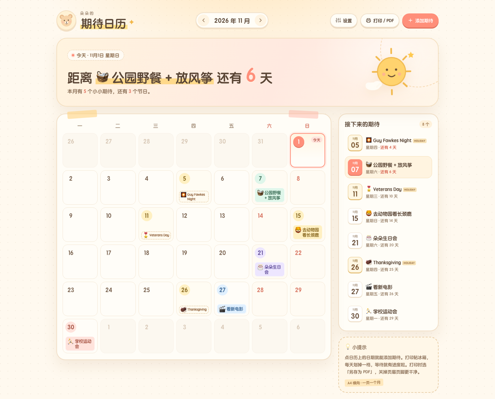

# 小小期待日历

> 给孩子看的「未来有什么好事要发生」日历。  
> 不管理时间，只负责把等待变得看得见、可爱、有仪式感。

在线使用：**https://limengke123.github.io/calendar_kids/**



- 打开 [A4 打印效果](design/print-preview.pdf) 看看打印版式。
- 示例名字是「朵朵」，点「设置」可以改成自己孩子的名字。

---

## 这是什么

孩子问「还有几天去动物园？」时，不用解释日期，指给她看就好。

- **家长**：花 30 秒添加几个期待。
- **孩子**：每天看一眼，知道下一件好事还有多久。
- **最终归宿**：打印出来贴在冰箱上，每天划掉一格。

### 三个核心体验

1. **一眼看到下一件好事**  
   顶部不是冷冰冰的日期，而是一句：「距离 🧺 公园野餐 还有 6 天」。

2. **有事件的日期像贴了贴纸**  
   孩子不需要读日程，靠颜色 + emoji 就能找到「我的日子」。

3. **打印出来是家里的一件小家具**  
   A4 一页一个月，留白舒服，贴冰箱不违和。

---

## 功能

- 月视图：周一开始、今天高亮、周末浅色、上下月切换
- 点日期添加期待；点贴纸编辑；支持删除
- 每个期待可以设置：日期、名字、emoji、颜色、一句备注
- 顶部「下一个期待」倒计时；右侧「接下来的期待」清单
- 自动保存在浏览器本地，刷新不丢
- 设置孩子名字
- 导出 / 导入 JSON 备份
- 一键打印 / 另存为 PDF，专用 A4 横向打印样式
- 手机、平板、桌面自适应
- 零依赖、离线可用，不需要登录

---

## 使用

### 在线版

打开 **https://limengke123.github.io/calendar_kids/**

数据只保存在当前浏览器里。换电脑、换浏览器或清理缓存前，记得在「设置」里导出备份。

### 本地打开

直接双击 `index.html`，或者：

```bash
cd kids-calendar
python3 -m http.server 8080
# 打开 http://localhost:8080
```

### 打印 / 导出 PDF

1. 点右上角「打印 / PDF」。
2. 浏览器打印对话框里选择「另存为 PDF」。
3. 纸张选 **A4 横向**，边距选默认或最小。
4. 建议关掉浏览器的页眉页脚，画面会更干净。

打印版会隐藏所有按钮和提示，只保留：孩子名字 + 月份、倒计时一句话、月历、「接下来的期待」清单。

---

## 数据与备份

数据存储在浏览器的 `localStorage`，键名：

```
kids-calendar:v1
```

导出的 JSON 结构大致如下：

```json
{
  "version": 1,
  "childName": "朵朵",
  "settings": { "weekStart": 1, "theme": "cream" },
  "events": [
    {
      "id": "evt_...",
      "date": "2026-11-07",
      "title": "公园野餐",
      "emoji": "🧺",
      "color": "mint",
      "note": "带上野餐垫和泡泡机",
      "createdAt": 1793515000001
    }
  ]
}
```

颜色可选：`mint` / `yellow` / `lav` / `sky` / `coral`。

导入会替换当前日历，导入前会二次确认。

---

## 设计说明

**奶油手账风**：

- 奶油纸张底色 + 马卡龙色贴纸
- 大圆角、粗描边、纸张阴影、和纸胶带细节
- 手绘感太阳 / 小熊吉祥物，少量星星点缀
- 大字号日期、短文案、emoji 当图标
- 字体不依赖网络：`Yuanti SC` / `PingFang SC` / `Microsoft YaHei` 系统圆体回退

色板：

| 用途 | 颜色 |
| --- | --- |
| 纸张底 | `#FFF9EF` |
| 卡片 | `#FFFDF7` |
| 文字 | `#5A4636` |
| 珊瑚主色 | `#FF8F7A` |
| 阳光黄 | `#FFD36E` |
| 薄荷绿 | `#8FD9B6` |
| 天空蓝 | `#8FC5F5` |
| 香芋紫 | `#B9A4F0` |

---

## 技术实现

纯静态单页，无构建步骤：

```
index.html        页面结构
styles.css        屏幕样式 + A4 打印样式
app.js            日历渲染、事件增删改、localStorage、JSON 备份
assets/favicon.svg
design/           截图与打印预览
.github/workflows/pages.yml
```

几个实现约定：

- 日期用 `YYYY-MM-DD` 本地日期字符串作为 key，避免 UTC 时区偏移。
- 倒计时用 `Date.UTC` 计算天数差，避免夏令时和时分秒误差。
- 打印使用原生 `window.print()` + `@page { size: A4 landscape; }`，不引入 html2canvas / jsPDF，PDF 里的文字是矢量的。
- 用户输入统一做 HTML 转义后再渲染。
- 没有后端；GitHub Pages 只托管静态文件。

---

## 部署

当前仓库已配置好：

- 推送到 `main` 后，`.github/workflows/pages.yml` 会把 `index.html`、`styles.css`、`app.js`、`assets/` 复制到 `_site`。
- 用 `peaceiris/actions-gh-pages` 把 `_site` 推送到 `gh-pages` 分支。
- GitHub Pages 的 Source 设置为 `Deploy from a branch` → `gh-pages` → `/ (root)`。
- 每次推送到 `main`，Actions 都会自动更新 `gh-pages` 和线上页面。

线上地址：**https://limengke123.github.io/calendar_kids/**

如果 fork 了这个仓库，需要在 **Settings → Pages** 里重新设置一次源分支。

---

## 接下来可以加

- 生日 / 纪念日按年重复
- 过去的事件盖「已实现」小印章
- 打印版附「倒计时打卡条」
- 家长编辑锁（避免孩子误删）
- 多孩子切换
- A4 纵向 / 全年 12 个月打印

暂时不做：账号、云同步、推送提醒、家庭共享。先用 JSON 备份解决数据安全。
